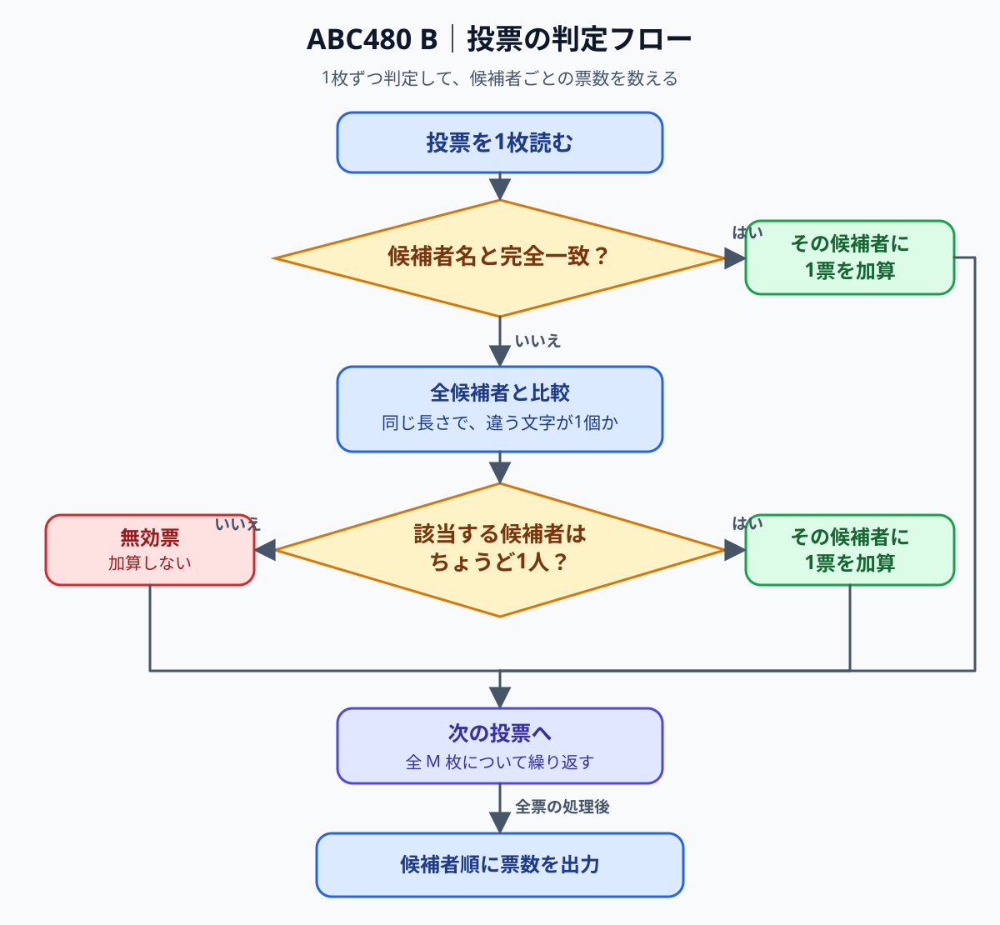

# ABC480 B: Invalid Vote — 解説と比較

- 問題: https://atcoder.jp/contests/abc480/tasks/abc480_b
- 参照元: https://atcoder.jp/contests/abc480/editorial/27254 （公式解説）
- 下の 2 つの C# コードは公式解説の方針をもとに作成した実装であり、公式掲載コードではない。

## 解法の要点

各投票を独立に判定する。同じ名前が投票リストに何度現れても、そのたびに 1 票を加算する。

1. 候補者名に完全一致したら、その候補者に 1 票を加算する。完全一致を優先する。
2. 完全一致しなければ、同じ長さで異なる文字がちょうど 1 個の候補者を探す。
3. その候補者がちょうど 1 人なら 1 票を加算する。0 人または 2 人以上なら無効票とする。
4. 最後に、候補者の入力順に票数だけを 1 行ずつ出力する。

### 解法の流れ



候補者数を `N`、投票数を `M`、名前の最大長を `L` とすると、どちらの実装も計算量は `O(MNL)`。模範解答の追加の作業領域は `O(NL)`、書きかけコードを完成させた版は投票も配列に保存するので `O((N+M)L)`。

## 模範解答

公式解説の方針に沿って、投票を読み取るたびに全候補者と比較する C# 実装。完全一致が見つかれば、その時点でほかの候補者との比較は不要になる。投票リストや辞書を保存せずに処理できる。

```csharp
using System;

internal static class Program
{
    private static void Main()
    {
        string[] first = Console.ReadLine()!.Split();
        int n = int.Parse(first[0]);
        int m = int.Parse(first[1]);

        string[] candidates = new string[n];
        for (int i = 0; i < n; i++)
        {
            candidates[i] = Console.ReadLine()!;
        }

        int[] counts = new int[n];
        for (int j = 0; j < m; j++)
        {
            string vote = Console.ReadLine()!;
            int exactIndex = -1;
            int oneDifferenceIndex = -1;
            int oneDifferenceCount = 0;

            for (int i = 0; i < n; i++)
            {
                if (candidates[i].Length != vote.Length)
                {
                    continue;
                }

                int differences = 0;
                for (int k = 0; k < vote.Length; k++)
                {
                    if (candidates[i][k] != vote[k])
                    {
                        differences++;
                    }
                }

                if (differences == 0)
                {
                    exactIndex = i;
                    break;
                }

                if (differences == 1)
                {
                    oneDifferenceIndex = i;
                    oneDifferenceCount++;
                }
            }

            if (exactIndex != -1)
            {
                counts[exactIndex]++;
            }
            else if (oneDifferenceCount == 1)
            {
                counts[oneDifferenceIndex]++;
            }
        }

        foreach (int count in counts)
        {
            Console.WriteLine(count);
        }
    }
}
```

## 備考：書きかけコードの不足点

- 候補者名を辞書で番号に対応付ける方針は、完全一致の確認に使える。
- `i < candidates.Count() - 1` と `i < votes.Count() - 1` では最後の要素が処理されない。配列なら `i < n` と `i < m` でよい。
- `candidateNumList.Append(candidateIndex)` は配列の票数を変更しない。該当する候補者の要素を `candidateNumList[candidateIndex]++` で増やす。
- `candidateDict[vote]` は辞書にない名前で例外になる。完全一致しない票も判定するため、`TryGetValue` を使う。
- 完全一致しない票について、1 文字違いの候補者がちょうど 1 人かを確認する処理が必要。
- 出力は候補者名やラベルを付けず、票数を `N` 行に分ける。

## 備考：書きかけコードを完成させた版

候補者と投票をそれぞれ配列に読み込み、候補者名から番号を引く辞書と、候補者ごとの票数配列を使う元の構成を残した修正版。公式解説の方針を C# で実装したもので、公式掲載コードではない。

```csharp
using System;
using System.Collections.Generic;

internal static class Program
{
    private static void Main()
    {
        string[] first = Console.ReadLine()!.Split();
        int n = int.Parse(first[0]);
        int m = int.Parse(first[1]);

        // 候補者リストの作成
        string[] candidates = new string[n];
        for (int i = 0; i < n; i++)
        {
            candidates[i] = Console.ReadLine()!;
        }

        // 投票リストの作成
        string[] votes = new string[m];
        for (int i = 0; i < m; i++)
        {
            votes[i] = Console.ReadLine()!;
        }

        // 候補者名から配列の位置を調べられるようにする
        var candidateDict = new Dictionary<string, int>();
        for (int i = 0; i < n; i++)
        {
            string candidate = candidates[i];
            candidateDict[candidate] = i;
        }

        // 候補者ごとの票数
        int[] candidateNumList = new int[n];

        // 投票を1枚ずつ判定する
        for (int i = 0; i < m; i++)
        {
            string vote = votes[i];

            // 完全一致する候補者がいれば、その候補者に1票
            if (candidateDict.TryGetValue(vote, out int candidateIndex))
            {
                candidateNumList[candidateIndex]++;
                continue;
            }

            // 完全一致しない場合、1文字だけ違う候補者を探す
            int matchingCandidateIndex = -1;
            int matchingCandidateCount = 0;
            for (int j = 0; j < n; j++)
            {
                if (candidates[j].Length != vote.Length)
                {
                    continue;
                }

                int differenceCount = 0;
                for (int k = 0; k < vote.Length; k++)
                {
                    if (candidates[j][k] != vote[k])
                    {
                        differenceCount++;
                    }
                }

                if (differenceCount == 1)
                {
                    matchingCandidateIndex = j;
                    matchingCandidateCount++;
                }
            }

            if (matchingCandidateCount == 1)
            {
                candidateNumList[matchingCandidateIndex]++;
            }
        }

        // 候補者の入力順に票数だけを出力する
        foreach (int count in candidateNumList)
        {
            Console.WriteLine(count);
        }
    }
}
```

## 次に解くときの着眼点

票を数える前に「この投票が誰の票になるか」を 1 枚ずつ決める。完全一致と 1 文字違いでは優先順位が異なり、1 文字違いが複数ある票は無効になることを確認する。
